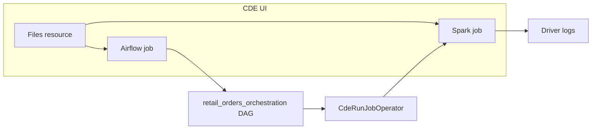

# Cloudera Data Engineering — Retail Orders Demo

This repository is a **customer-ready example** for **Cloudera Data Engineering (CDE)** on CDP (including on-premises). It includes:

1. A **PySpark** job that generates sample retail orders, validates them, and prints analytics to the driver logs.
2. An **Apache Airflow DAG** that **orchestrates** that Spark job using CDE’s built-in operators.

**Everything is deployed through the CDE UI** (resources + jobs). No CLI is required.

## Use case

**Business flow:** Daily retail order data is processed with data-quality checks and revenue summaries.

**Technical flow:**

| Layer | What happens |
|--------|----------------|
| **Spark** | Generates orders in memory → validates → computes revenue → aggregates by region/category → prints to **CDE driver logs** (no HDFS/Ozone/Hive writes). |
| **Airflow** | Starts a workflow → **triggers the Spark CDE job** → marks complete. Optional retries and task timeout are configured in the DAG. |

There are **no** input CSV files and **no** external storage dependencies.

## Repository contents

| Path | Purpose |
|------|---------|
| `src/basic_cde_spark_job.py` | Spark application file |
| `dags/retail_orders_orchestration_dag.py` | Airflow DAG file (orchestrates the Spark job) |

Use **one Files resource** for both files, or separate resources if your standards require it.

## Prerequisites

- CDE **virtual cluster** with Spark and the managed **Airflow** service enabled.
- Permission to create **Resources** and **Jobs** in the CDE UI.

## Naming convention (important)

Use the same names in the UI and in the DAG, or edit the DAG constant to match your UI.

| Artifact | Suggested name |
|----------|----------------|
| Files resource | `retail-orders-demo-files` |
| Spark job | `retail-orders-spark-demo` |
| Airflow job | `retail-orders-airflow-demo` |

The DAG file sets `SPARK_CDE_JOB_NAME = "retail-orders-spark-demo"`. If you pick a different Spark job name in the UI, update that variable in `dags/retail_orders_orchestration_dag.py` before upload.

---

## Part A — Spark job (CDE UI)

### A1 — Create a Files resource

1. Open your **virtual cluster** in the CDE UI.
2. **Resources** → **Create Resource**.
3. **Type:** Files  
4. **Name:** e.g. `retail-orders-demo-files`

### A2 — Upload the Spark script

Upload from this repo:

```text
src/basic_cde_spark_job.py
```

Note the path inside the resource after upload (often `basic_cde_spark_job.py` at the resource root).

### A3 — Create the Spark job

1. **Jobs** → **Create Job** → **Spark**.
2. **Name:** `retail-orders-spark-demo` (or your name; keep in sync with the DAG).
3. **Application file:** path inside the mount, e.g. `basic_cde_spark_job.py`.
4. **Mount:** the Files resource from A1.
5. **Application arguments:** none.
6. Optional Spark config:

| Key | Value |
|-----|--------|
| `spark.sql.adaptive.enabled` | `true` |
| `spark.sql.shuffle.partitions` | `4` |

### A4 — Test the Spark job

Run the job once from the UI. Open **driver logs** and confirm sections such as:

```text
=== Raw Generated Orders ===
=== Valid Orders With Revenue ===
=== Rejected Orders ===
=== Revenue By Region ===
=== Revenue By Product Category ===
=== Job Summary ===
```

The Spark job must **succeed** before the Airflow DAG can orchestrate it.

---

## Part B — Airflow DAG (CDE UI)

Create the Spark job **first**. The DAG only **calls** that existing job by name.

### B1 — Upload the DAG file

Add to the **same** Files resource (or a dedicated one):

```text
dags/retail_orders_orchestration_dag.py
```

### B2 — Create the Airflow job

1. **Jobs** → **Create Job** → **Airflow** (not Spark).
2. **Name:** e.g. `retail-orders-airflow-demo`.
3. **DAG file:** path inside the mount, e.g. `retail_orders_orchestration_dag.py`.
4. **Mount** the resource that contains the DAG file.
5. Save.

### B3 — Run the Airflow job

1. **Run** the Airflow job from the UI.
2. In the Airflow UI for your virtual cluster (or job run details), open DAG **`retail_orders_orchestration`**.
3. Confirm task flow: `start` → `run_retail_orders_spark` → `end`.
4. When `run_retail_orders_spark` succeeds, open the **Spark job run** it triggered and review the same driver log output as in Part A.

### B4 — Scheduling (optional)

The DAG uses `schedule_interval=None` (manual / trigger-only). To run on a schedule, change `schedule_interval` in the DAG file (for example `@daily`), re-upload to the resource, and update the Airflow job if your environment requires a refresh.

---

## CDE connection from Airflow (`connection_id`)

`CdeRunJobOperator` needs to know **which CDE virtual cluster** hosts the Spark job. That is controlled by the Airflow **connection** passed as `connection_id`.

### Same virtual cluster (this demo — default)

If the **Airflow job** and the **Spark job** are on the **same** CDE virtual cluster, you usually **do not** need extra setup:

- In `dags/retail_orders_orchestration_dag.py`, leave:
  ```python
  CDE_CONNECTION_ID = None
  ```
- CDE resolves the Spark job on the VC where the Airflow job is running.

On many CDP versions, a built-in connection such as **`cde_runtime_api`** points at the current VC. You only need to set `CDE_CONNECTION_ID` if your environment’s docs tell you to use that explicit id instead of omitting it.

### Different virtual cluster (cross-VC)

If Airflow runs on **VC-A** but the Spark job is defined on **VC-B**, create an Airflow connection to VC-B, then set `CDE_CONNECTION_ID` in the DAG to that connection’s **Conn Id**.

1. In **Cloudera Data Engineering**, open **VC-B** → **Cluster details** → copy the **Jobs API URL**.
2. Open the **Airflow UI** for the VC where this DAG runs (CDE → your VC → **Airflow UI**).
3. **Admin** → **Connections** → **Add**.
4. Typical fields (labels vary by CDP version):

   | Field | Value |
   |--------|--------|
   | **Conn Id** | e.g. `cde_vc_prod` (you choose; use this in the DAG) |
   | **Conn Type** | **Cloudera Data Engineering** |
   | **Host / Virtual Cluster API endpoint** | Jobs API URL for **VC-B** |
   | **Login / Access key** | CDP access key allowed to run jobs on VC-B |
   | **Password / Private key** | Matching CDP private key |

5. In the DAG file:
   ```python
   CDE_CONNECTION_ID = "cde_vc_prod"
   ```
6. Re-upload the DAG to your Files resource and run the Airflow job again.

The Spark job **`retail-orders-spark-demo`** must exist on the **target** VC (the one the connection points to), not only on the VC where Airflow is deployed.

### External Airflow (not CDE-managed)

If you run Airflow **outside** CDE, install the Cloudera Airflow provider and create the same **Cloudera Data Engineering** connection in that Airflow deployment (Jobs API URL + CDP keys). See Cloudera docs: *Using Cloudera Data Engineering with an external Apache Airflow deployment*.

### Reference in this repo

| Setting | Location |
|---------|----------|
| `CDE_CONNECTION_ID` | Top of `dags/retail_orders_orchestration_dag.py` |
| Operator argument | Passed as `connection_id` only when `CDE_CONNECTION_ID` is set |

---

## Architecture



## Operator compatibility

CDE versions differ slightly:

- Newer: `cloudera.airflow.providers.operators.cde.CdeRunJobOperator`
- Older: `cloudera.cdp.airflow.operators.cde_operator.CDEJobRunOperator`

The DAG file tries both imports automatically. If parsing fails, check your CDP version’s Airflow provider documentation.

## Troubleshooting

| Issue | Check |
|--------|--------|
| Airflow task fails immediately | Spark job **name** in UI matches `SPARK_CDE_JOB_NAME` in the DAG file. |
| Spark job not found | Spark job exists on the **same** virtual cluster, or set `CDE_CONNECTION_ID` in the DAG. |
| DAG not visible | Airflow job **DAG file** path matches upload path; remount resource after DAG changes. |
| No output tables | View **Spark** driver logs for the run created by the Airflow task. |
| Import error in DAG | Provider package on your CDE Airflow image; adjust import per Cloudera docs for your version. |

## Customization

- **Sample data / rules:** edit `src/basic_cde_spark_job.py`, re-upload, re-run Spark (or via Airflow).
- **Orchestration:** edit `dags/retail_orders_orchestration_dag.py` (retries, `execution_timeout`, schedule, extra tasks).

## Support

Use Cloudera documentation for your CDP version: CDE resources, Spark jobs, and Airflow jobs. This repository is a reference sample only.
